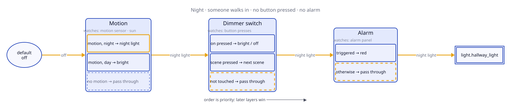
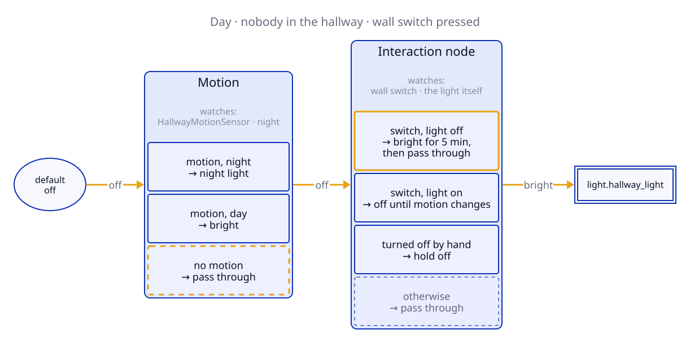
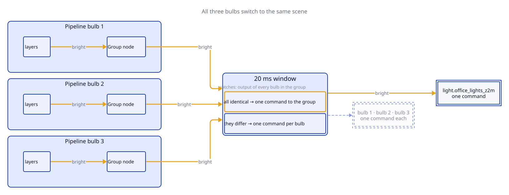
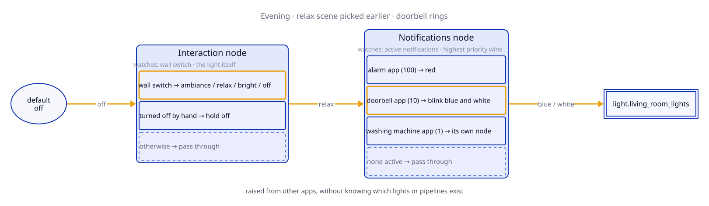

<!--
PUBLISHING NOTES (strip this block before publishing)

Title:      Supercharging Home Assistant Automations: Layered Light Pipelines for NetDaemon
            (reads as part 2 of the series; use the line below as the dev.to description / social blurb)
Description: I dropped the Hue Bridge for Home Assistant and had to rebuild everything it did. Here is the model that kept it manageable.
Tags:       homeassistant, csharp, dotnet, programming   (part 1 used programming; it is the larger tag)
Series:     neither dev.to post is in a series yet. Pick a name, e.g. "Supercharging Home Assistant Automations",
            put it in the front matter here AND edit part 1 on dev.to to add the same value.
Canonical:  publish on jasperlammers.com first, set that URL as canonical_url on dev.to
Front matter for dev.to (markdown editor mode):
            ---
            title: Supercharging Home Assistant Automations: Layered Light Pipelines for NetDaemon
            published: false
            description: <see above>
            tags: homeassistant, csharp, dotnet, programming
            series: Supercharging Home Assistant Automations
            canonical_url: https://jasperlammers.com/<slug>/
            cover_image: <url, 1000x420>
            ---
Cover:      TODO (the "Thinking in Layers" flowchart exported at 1000x420 would work)
Diagrams:   D2 sources in docs/article/*.d2 (shared style in _style.d2), rendered to .svg and .png
            with `sh docs/article/render.sh`. The SVGs follow light/dark mode; upload the PNGs to dev.to (it doesn't take SVG) and the SVGs
            to WordPress, then replace the relative image paths with the uploaded URLs.
Release:    the start-up fix on branch feature/interaction-window is not in 1.27.0 yet; publish after it ships.

Every HTML comment starting with REVIEW needs a decision or your real content.
-->

## 📖 Table of Contents
- [Introduction](#introduction)
- [What You Lose Without the Bridge](#what-you-lose-without-the-bridge)
- [Rebuilding It in YAML](#rebuilding-it-in-yaml)
- [Thinking in Layers](#thinking-in-layers)
- [Building a Room, One Line at a Time](#building-a-room-one-line-at-a-time)
    - [The Hallway](#the-hallway)
    - [The Office](#the-office)
    - [The Attic](#the-attic)
    - [The Living Room](#the-living-room)
- [From Alarm to Notifications](#from-alarm-to-notifications)
- [Seeing Which Layer Won](#seeing-which-layer-won)
- [Cheat Sheet](#cheat-sheet)
- [Things to Know Before You Start](#things-to-know-before-you-start)
- [Conclusion](#conclusion)
- [Libraries](#libraries)

> 🔗 You can find the full source code of the libraries on [GitHub](https://github.com/DevJasperNL/CodeCasa). Every room in this article is taken from my [showcase repository](https://github.com/DevJasperNL/CodeCasa.Showcase), a trimmed-down copy of my own home automation.

## Introduction

My smart home started the way many do: with a Philips Hue starter kit. I screwed in the bulbs, stuck a dimmer switch to the wall and everything just worked. The switch cycled through scenes, holding a button dimmed the lights, and the motion sensor in the hallway knew the difference between day and night.

Then I discovered Home Assistant, and with it the freedom to connect my lights to everything else in the house. At some point I took the next step and retired the Hue Bridge altogether, pairing the bulbs, switches and sensors directly to my own Zigbee network through Zigbee2MQTT.

That's when I found out how much the bridge had been doing for me. All the behaviour I took for granted was gone, and rebuilding it turned out to be a lot more work than I expected. This article is about that work, about why it gets messy so quickly, and about the library I built to keep it manageable: **CodeCasa.AutomationPipelines.Lights**.

This is the second article in a series about patterns for [NetDaemon](https://netdaemon.xyz/), which lets you write Home Assistant automations as C# applications, with entities exposed as strongly typed objects and state changes as observables. The [first one](https://dev.to/devjaspernl/supercharging-home-assistant-automations-initial-states-and-boolean-logic-for-netdaemon-rx-3bd5) introduced stateful boolean observables. Every node in this article is driven by one, but you can follow along without having read it.

## What You Lose Without the Bridge

Once your Hue devices talk to Home Assistant directly, a dimmer switch is no longer a dimmer switch. It's a device that emits button events. A motion sensor is a binary sensor. What you do with them is entirely up to you, which sounds great until you write down what the bridge used to do:

- Pressing the **on** button (the **Hue** button on the newer switch) repeatedly cycles through scenes, as long as the presses follow each other quickly.
- **Holding** a button dims or brightens smoothly until you let go.
- The motion sensor uses different scenes for **day and night**, and can be told to leave a room alone when the lights are already on.
- **Natural light** shifts colour temperature and brightness through the day in a handful of time blocks.
- A whole room is addressed with **one command**, not one per bulb.
- A bulb that was **switched off at the wall** comes back in the state the room is in.

And then there were the things the bridge never quite did, but that I had always wanted: turning a light off by hand should **stick** instead of the motion sensor turning it right back on, and a doorbell or an alarm should be able to take the lights over for a moment and give them back afterwards.

> 💡 **Note:** If you keep the Hue Bridge and use Home Assistant's Hue integration, none of this applies. The bridge keeps running its own logic. This article is about the situation where Home Assistant is the only brain left. You don't need Hue for any of it, either. Any bulb, button and motion sensor that shows up in Home Assistant has the same problem: several automations writing to one light, with nobody deciding who wins.

## Rebuilding It in YAML

None of these features is hard to build on its own. Here is a motion automation with a day and night scene:

```yaml
- alias: Hallway motion
  triggers:
    - trigger: state
      entity_id: binary_sensor.hallway_motion
      to: "on"
  actions:
    - choose:
        - conditions:
            - condition: state
              entity_id: sun.sun
              state: below_horizon
          sequence:
            - action: scene.turn_on
              target:
                entity_id: scene.hallway_nightlight
      default:
        - action: scene.turn_on
          target:
            entity_id: scene.hallway_bright
```

Add a second automation that turns the lights off two minutes after the last motion and you have a working room. But then you add the wall switch, and the first problem shows up. Someone switches the hallway to bright to find something in the cupboard, and two minutes later the motion automation turns the lights off on them. The fix is an `input_boolean.hallway_manual` helper that the switch automation sets and both motion automations check.

Now imagine you want the lights to turn red when the security alarm is triggered. Turning them red is one more automation. However, to make it work you now need to update every other automation:

```yaml
  # inside each of the other automations:
  conditions:
    - condition: state
      entity_id: input_boolean.hallway_manual
      state: "off"
    - condition: not
      conditions:
        - condition: state
          entity_id: alarm_control_panel.home
          state: triggered
```

This block has to go into the motion-on automation, the motion-off automation and every button of the switch automation, because any of them would happily overwrite the red light. And when the alarm ends, what should the room look like? Whatever it *would* have looked like without the alarm, which no single automation knows.

There are workarounds. You can snapshot the lights with `scene.create` and restore them afterwards, but then you restore a moment from the past: if the sun set or everybody left during the alarm, the room comes back wrong. You can disable the other automations with `automation.turn_off`, but then the triggers that fired in the meantime are lost. Both work until they don't. Blueprints such as the built-in *Motion-activated Light* and integrations like *Adaptive Lighting* each solve one of these problems well. What none of them give you is a place where the pieces meet.

The underlying issue is that every automation writes to the light directly, and nothing decides who wins. Home Assistant gives you triggers, conditions and actions, but it has no built-in notion of priority between automations. So every cross-cutting concern ends up as a condition in all of them. What is missing is not another trigger. It is a model.

## Thinking in Layers

The model I ended up with is a pipeline per light. A pipeline is an ordered list of nodes, and each node represents one concern, a layer of behaviour: motion, the switch, the alarm. A node receives the output of the node before it and then does one of two things. It either sets its own output, or it **passes through** what it received, which is its way of saying "I have no opinion right now". What sets this apart from an ordinary pipeline is that a node does not only react to its input. Like a NetDaemon app, every node is an automation of its own: it can watch a sensor, a button or a timer and change its output at any moment. That is why the library calls these automation pipelines.



<!-- REVIEW: add a GIF of the room responding, or a screenshot of the telemetry in Home Assistant (see Seeing Which Layer Won). -->

Later nodes win over earlier ones, so the order of the list *is* the priority. Every pipeline starts with a default value, off, which is what the first node receives as its input. A pipeline in which every node passes through therefore turns the light off. The light is only ever driven from the end of the pipeline, and no node knows about any other node. The motion layer keeps tracking motion while the alarm is active, so when the alarm node goes back to passing through, the room is immediately in the state it should be in at that moment. Nothing needs to be restored.

There is a third thing a node can do: take what it receives and change it. `LimitBrightnessWhen(night, 100)` caps the brightness of every layer before it, whatever scene they picked, and leaves colour and off alone. Most of this article is about the first two, but it is good to know the option exists.

The pipeline machinery lives in a small generic library, `CodeCasa.AutomationPipelines`. On top of it, `CodeCasa.AutomationPipelines.Lights` adds a fluent API for lights, and `CodeCasa.AutomationPipelines.Lights.NetDaemon` adds overloads for Home Assistant entities and scenes. That last package is the one to install. Registering everything used in this article looks like this:

```csharp
services
    .AddNetDaemonScheduler()   // NetDaemon's IScheduler; everything time-based uses it
    .AddLightPipelines()
    .AddLightScenes()          // only if you pass Home Assistant scene entities (The Living Room)
    .AddLightNotifications();  // only for the notification layer (From Alarm to Notifications)
```

Everything time-based in the library takes an `IScheduler` from System.Reactive. In production that's the normal clock; in tests it's a virtual one, so a five-minute timeout can be tested in a millisecond.

## Building a Room, One Line at a Time

Four rooms from the [showcase](https://github.com/DevJasperNL/CodeCasa.Showcase) are enough to rebuild the list from the start of this article: the hallway, the office, the attic and the living room.

A word on the inputs first. NetDaemon generates classes such as `LightEntities`, `SensorEntities` and `SceneEntities` from your Home Assistant instance, so `lightEntities.HallwayLight` *is* `light.hallway_light`. An app is a class marked `[NetDaemonApp]`, and NetDaemon constructs it through dependency injection, which is where every constructor parameter below comes from. Without the bridge, a switch is just a Zigbee2MQTT device publishing button events. In the showcase these are wrapped in small classes that I register alongside the apps: `HallwayWallSwitch` is an `IObservable<Unit>` that emits on every press (`Unit` is Rx's way of saying "something happened, no value attached"), and `OfficeDimmerSwitch` exposes `OnOffPressed`, `ScenePressed`, `Dimming` and `Brightening`.

Wherever the API wants a light state, it accepts one of three things: a `LightParameters` object (brightness 0 to 255, a colour or a colour temperature; `Bright`, `Relax`, `NightLight`, `Concentrate` and `Dimmed` are built-in presets you can overwrite), a Home Assistant scene entity, or a timeline. Internally everything becomes a `LightTransition`, parameters plus a transition time.

### The Hallway

If you read part one, this is the upstairs hallway light from that article, now as a pipeline.

#### Motion

The hallway has a Hue motion sensor, which Zigbee2MQTT exposes as an occupancy binary sensor and an illuminance sensor. `MotionSensor` from `CodeCasa.NetDaemon.Sensors.Composite` combines the two:

```csharp
public class HallwayMotionSensor(
    IScheduler scheduler,
    BinarySensorEntities binarySensorEntities,
    SensorEntities sensorEntities)
    : MotionSensor(scheduler, binarySensorEntities.HallwayMotionSensorOccupancy,
        sensorEntities.HallwayMotionSensorIlluminance);
```

The result is a stateful `IObservable<bool>`. Stateful means it emits its current value the moment you subscribe, not only on the next change, so a pipeline that starts at eleven at night immediately knows that nobody is in the hallway. It becomes `true` when there is movement and the room is dark, and stays `true` until a minute after the last movement. That one observable replaces the motion-on automation, the motion-off automation and the illuminance condition.

#### Day and Night

The pipeline is a single `SwitchWhen`. It takes the observable that activates the node and a second one that chooses between two outcomes:

```csharp
var night = PeriodTimeline.Between(AstroInstants.LocalSunsets, AstroInstants.LocalSunrises).ToBooleanObservable(scheduler);

lightPipelineFactory.SetupLightPipeline(lightEntities.HallwayLight, pipeline => pipeline
    .SwitchWhen(hallwayMotionSensor, night, LightParameters.NightLight, LightParameters.Bright)
    // ...
```

`night` comes from [Occurify](https://dev.to/devjaspernl/occurify-fluent-time-modeling-for-net-developers-3e4n), my library for modelling time as instants and periods. `AstroInstants.LocalSunsets` is the recurring sunset for the coordinates you configure once at startup, `PeriodTimeline.Between` turns sunsets and sunrises into night periods, and `ToBooleanObservable` makes that a stateful observable that is `true` during those periods. If you'd rather not, `sun.sun` as a boolean observable works too.

While the motion sensor is `false` the node passes through, and since there is nothing before it the pipeline falls back to its default, which is off. Because both observables are stateful, this works at startup and at the moment the sun sets while somebody is in the hallway. The `choose` block from the YAML version is gone. Without the day and night distinction it would simply be `When(hallwayMotionSensor, LightParameters.Bright)`.

#### Bright for Five Minutes

The hallway also has a wall switch. Sometimes you want proper light for a while, to find something in the cupboard, and then you want the hallway to go back to doing its own thing. The switch gets its own node, placed after the motion node, so it wins:

```csharp
    .AddInteractionNode(node => node
        .AddToggle(hallwayWallSwitch, sp => sp.CreateAutoPassThroughLightNode(LightParameters.Bright, TimeSpan.FromMinutes(5)))));
```

The lambda is a *node factory*: a function that receives the service provider and builds the node when the toggle activates, so every press gets a fresh five-minute timer.

`AddToggle` decides from the actual state of the light. If it's off, a press activates the node: bright, for five minutes. After that the node does not turn the light off. It starts passing through. If there is still motion, the hallway falls back to the motion scene. If not, it goes dark. If the light is already on when the switch is pressed, from motion or from an earlier press, it turns off and stays off until the motion layer changes. There's also `CreateAutoOffLightNode` for when the timeout should turn the light off instead.

This is also where the `input_boolean.hallway_manual` helper went. While the switch node is active, the motion layer keeps doing its thing underneath, but its output never reaches the light. When motion ends it passes through, which changes nothing, because the switch layer is still in charge. Nothing needs to check a flag.

> 💡 **Note:** Deciding from the actual state has one catch. Walk into the hallway at night, the motion sensor turns the light on, and half a second later you press the switch, because you wanted proper light anyway. A plain toggle would see "on" and turn the light off. `AddToggle` therefore has a grace window, one second by default: if the light changed within that window and this toggle was not the cause, the press is judged against the state *before* the change. `SetGracePeriod` on the toggle configurator changes the window.

`AddInteractionNode` does one more thing: it watches the light itself. When somebody turns it off from outside the pipeline, with the Home Assistant app for example, the node holds it off until something earlier in the pipeline changes. Turning a light off by hand sticks. With `HoldExternalChanges` enabled it does the same for a scene or brightness set from outside, optionally for a limited time, so your existing YAML automations and the pipeline can coexist.

Put together, the whole app is this:

```csharp
[NetDaemonApp]
internal class HallwayLightsApp
{
    public HallwayLightsApp(
        LightPipelineFactory lightPipelineFactory,
        LightEntities lightEntities,
        HallwayMotionSensor hallwayMotionSensor,
        HallwayWallSwitch hallwayWallSwitch,
        IScheduler scheduler)
    {
        var night = PeriodTimeline.Between(AstroInstants.LocalSunsets, AstroInstants.LocalSunrises).ToBooleanObservable(scheduler);

        lightPipelineFactory.SetupLightPipeline(lightEntities.HallwayLight, pipeline => pipeline
            .EnableLogging("Hallway")
            .SwitchWhen(hallwayMotionSensor, night, LightParameters.NightLight, LightParameters.Bright)
            .AddInteractionNode(node => node
                .AddToggle(hallwayWallSwitch, sp => sp.CreateAutoPassThroughLightNode(LightParameters.Bright, TimeSpan.FromMinutes(5)))));
    }
}
```



That is the whole hallway, in [one file](https://github.com/DevJasperNL/CodeCasa.Showcase/blob/main/src/CodeCasa.Automations/Apps/Lights/Hallway/HallwayLightsApp.cs).

### The Office

#### The Wall Switch and the Dimmer

The office has a wall switch and a Hue dimmer switch. Its pipeline doesn't use motion; I sit still for long enough that motion would be wrong more often than right. The complete pipeline:

```csharp
lightPipelineFactory.SetupLightPipeline(lightEntities.OfficeLights, pipeline => pipeline
    .UseLightGroup(lightEntities.OfficeLightsZ2m)
    .AddInteractionNode(node => node
        .AddToggle(officeWallSwitch, LightParameters.Bright)
        .AddToggle(officeDimmerSwitch.OnOffPressed, LightParameters.Bright)
        .AddCycle(officeDimmerSwitch.ScenePressed, LightParameters.Bright, LightParameters.Concentrate, LightParameters.Relax)
        .AddReactiveDimmer(officeDimmerSwitch)
        .TurnOffWhenLastPersonToAsleepOrAway()));
```

There is a lot of Hue behaviour in these few lines:

- The two `AddToggle` calls make the wall switch and the **on** button of the dimmer toggle between off and bright.
- `AddCycle` is the scene button. Where the bridge counts presses, this looks at the **actual state** of the lights on every press to decide which scene comes next, with some tolerance, because a bulb asked for 255 will happily report 254. If the state isn't recognised, the cycle starts at the first scene. `LightParameters.Bright` and friends are built-in scenes, plain parameter sets really; the living room below uses Home Assistant scenes instead.
- `AddReactiveDimmer` implements hold to dim, and does a little more than the bridge did. More on that below.
- `TurnOffWhenLastPersonToAsleepOrAway` is not from the library. It's a [ten-line extension method](https://github.com/DevJasperNL/CodeCasa.Showcase/blob/main/src/CodeCasa.CustomEntities.Automation/Extensions/LightTransitionReactiveNodeConfiguratorExtensions.cs) in the showcase, built on `AddNodeSource`, the primitive that all of the above is sugar for. Your own concerns slot in next to the built-in ones.

#### Holding the Button

`AddReactiveDimmer` takes an `IDimmer`, a tiny interface with two observables, `Dimming` and `Brightening`, which `OfficeDimmerSwitch` implements. While one of them is `true`, the brightness changes by 51, a fifth of the 0 to 255 range: once straight away, then every 400 ms. Only the brightness changes; colours stay as they are. The dimmer starts from whatever the interaction node is showing, so you dim the current scene, and it resets as soon as the interaction node switches to something else, so the next scene press shows that scene at its own brightness again.

<!-- REVIEW: the dimmer's adjustment is an offset that only resets on ReactiveNode.NodeChanged, not when a child starts passing through (e.g. CreateAutoPassThroughLightNode timing out). Brighten, then let upstream go to off: CalculateBrightness(0) stays positive and the light stays on. Fix in the library, or say here that the adjustment sticks until the next scene press. -->

With a single bulb that is all there is to it. With several bulbs it gets more interesting. Holding the dim button brings all bulbs down together until each reaches the minimum brightness, 2 out of 255 by default, where it waits for the others. Once all of them are at the minimum, the next step turns one bulb off, the step after that the next one, until the last bulb goes out. Holding the brighten button does the same in reverse: from a dark room, the bulbs come on at the minimum one at a time, in the opposite order, and once all of them are on they rise together to full brightness. You can dim a room down to one soft bulb in the corner without reaching for an app.

None of this is something you could have asked the bridge for. Nobody needs their lights to go out one by one, but this is the fun part of owning every step between the button and the bulb: when you have an idea of how a room should behave, you write it down.

By default the bulbs go out in the order the group lists them in Home Assistant. To choose your own order, and to change the minimum, the step size or the speed, pass `DimmerOptions` along with the dimmer. `AsLight()` wraps a Home Assistant entity as the library's `ILight`:

```csharp
var dimmerOptions = new DimmerOptions { MinBrightness = 10 };
dimmerOptions.SetLightOrder(
    lightEntities.OfficeCeilingLight.AsLight(),
    lightEntities.OfficeWindowLight.AsLight(),
    lightEntities.OfficeDeskLight.AsLight());  // the desk lamp stays on longest

lightPipelineFactory.SetupLightPipeline(lightEntities.OfficeLights, pipeline => pipeline
    .UseLightGroup(lightEntities.OfficeLightsZ2m)
    .AddInteractionNode(node => node
        // toggles and cycle as before
        .AddReactiveDimmer(officeDimmerSwitch)
        .SetReactiveDimmerOptions(dimmerOptions)));
```

<!-- REVIEW: the three office entity names are placeholders; use the bulbs from the showcase. -->

The order must list exactly the bulbs in the pipeline, the bulbs themselves rather than the group, or setup throws.

<!-- REVIEW: the AddDimmer sentence was removed because it was wrong. On a multi-bulb pipeline AddDimmer (= AddUncoupledDimmer) also does the one-at-a-time behaviour, starts from the bulb's reported state, and then pins that level (StaticLightTransitionNode) so earlier layers have no effect until the next dim step. Decide whether that's intended before mentioning it again. -->


#### One Command for the Whole Room

That leaves one item on the list for the office. `lightEntities.OfficeLights` is a Home Assistant light group, a software list of three bulbs. The library flattens it and builds one pipeline per bulb, because scenes can give every bulb its own colour and, as you'll see later, notifications can choose which bulbs they apply to. The downside is that a scene change results in three separate Zigbee commands instead of one. That's more traffic on the network, and if one of those commands is delayed or dropped, the bulbs end up in different states. The bridge avoided this by addressing the Zigbee group. `UseLightGroup`, the first line of the pipeline, does the same with `OfficeLightsZ2m`, a group created in Zigbee2MQTT that Zigbee itself understands, so one command reaches all bulbs. The pipeline's lights must be exactly the members of that group. The library can only check this when Home Assistant lists the group's members, which it doesn't for a Zigbee2MQTT group, so keeping the two in sync is up to you.

Each bulb's output is held back for a very short window, 20 ms by default. If all members of the group ask for the same thing within that window, a single command goes to the group. If they differ, for instance because a scene gives every bulb its own colour, each bulb is driven individually. You get the single command when it's possible and the per-bulb control when it's needed. The dimmer from the previous section plays along: while all bulbs dim together from the same scene, each step is one group command; once they start going out one by one, each bulb is driven on its own.



One more bridge feature comes for free here. A bulb that is switched off at the wall misses every command sent while it was gone. When it reports available again, the pipeline re-applies its current output, so the bulb joins the room in the state it should be in. This is on by default and can be turned off with `ReapplyOutputWhenAvailable(false)`.

> 💡 **Note:** If every bulb in a room always shows the same thing, you can skip the split and the 20 ms wait altogether by setting up the pipeline for the Zigbee2MQTT group itself: `SetupLightPipeline(lightEntities.OfficeLightsZ2m, ...)`. The library only splits a light into bulbs when Home Assistant lists its members in an `entity_id` attribute, which a light group has and a Zigbee2MQTT group doesn't, so this gives you a single pipeline that drives the group entity. You give up everything that works per bulb: scenes with a colour per bulb, notifications on some of the bulbs, the dimmer's one-at-a-time behaviour, noticing that one bulb was turned off by hand, and re-applying the output to one bulb that comes back from the wall switch. Pick one of the two setups per room; two pipelines driving the same bulbs bring back the question of who wins.

<!-- REVIEW: check in Developer Tools > States that your Zigbee2MQTT group entities indeed have no entity_id attribute. -->


### The Attic

Hue's natural light can be rebuilt with an Occurify timeline. A timeline maps moments of the day to light parameters, and the pipeline interpolates between them continuously. In the attic the wall switch toggles a timeline instead of a fixed scene:

```csharp
Action<ITimelineConfigurator> naturalLight = tl => tl
    .Add(AstroInstants.LocalSunrises, LightParameters.Bright)
    .Add(AstroInstants.LocalSunsets.OffsetHours(-2), LightParameters.Bright)
    .Add(AstroInstants.LocalSunsets, LightParameters.Dimmed)
    .Add(TimeZoneInstants.DailyAt(5), LightParameters.Dimmed);

lightPipelineFactory.SetupLightPipeline(lightEntities.AtticLights, pipeline => pipeline
    .UseLightGroup(lightEntities.AtticLightsZ2m)
    .AddInteractionNode(node => node
        .AddToggle(atticWallSwitch, naturalLight)));
```

From sunrise until two hours before sunset the attic is bright. Over the last two hours of daylight it drifts to dimmed, slowly enough that nobody notices, stays dimmed until five in the morning, and ramps back up to bright at sunrise. Between two entries the pipeline always interpolates, so holding a value means adding it twice: once where the hold starts and once where it ends. Where Hue's natural light steps through time blocks, this is one continuous ramp, and when a ramp involves colour the blend is gamma-corrected, with a gamma I tuned against my own Hue bulbs until it matched their native transition. Timelines are accepted wherever parameters are: `When(motion, naturalLight)` for a motion layer, or as an entry in a toggle or cycle.

### The Living Room

The living room scenes were made in the Home Assistant scene editor, with a different colour per bulb, and I wanted to keep them. The NetDaemon package accepts scene entities everywhere light parameters are accepted, provided `AddLightScenes()` is registered:

```csharp
lightPipelineFactory.SetupLightPipeline(lightEntities.LivingRoomLights, pipeline => pipeline
    .UseLightGroup(lightEntities.LivingRoomLightsZ2m)
    .AddInteractionNode(node => node
        .AddToggle(livingRoomWallSwitch,
            sceneEntities.LivingRoomAmbiance,
            sceneEntities.LivingRoomRelax,
            sceneEntities.LivingRoomBright)
        .TurnOffWhenLastPersonToAsleepOrAway())
    .AddNotifications());
```

A toggle with several entries is the Hue **on** button: the first press gives the first scene, presses within a second of each other walk through the others and wrap around, and a press after a pause turns the lights off. Unlike `AddCycle`, the toggle's main job is on and off; the extra scenes are only reachable by pressing again quickly. `SetToggleTimeout` changes the window. Each scene is read from Home Assistant once, and each bulb's pipeline picks its own part of it.

The last line, `AddNotifications`, is where the alarm from the YAML chapter ends up.

## From Alarm to Notifications

In a pipeline, the alarm from the YAML chapter could simply be one last node, `When(alarmTriggered, red)`, that wins over everything and knows nothing about motion, switches or timeouts.

But an alarm is just one reason to take over the lights for a while. The doorbell, the washing machine and the smoke detector are others, and none of them belong in the living room code. For this there is a separate package, `CodeCasa.Notifications.Lights`, registered with `AddLightNotifications()` as shown earlier. Every pipeline that should show notifications opts in with the line you saw in the living room:

```csharp
    .AddNotifications();
```

Any other application can now raise a notification, without knowing which lights or pipelines exist. It shows up as the last layer of every pipeline that opted in:



In the showcase, the doorbell is the one raising notifications:

```csharp
[NetDaemonApp]
internal class DoorbellLightNotifications
{
    public DoorbellLightNotifications(
        FrontDoorDoorbell frontDoorDoorbell,
        LightNotificationContext lightNotifications,
        IScheduler scheduler)
    {
        const string notificationId = nameof(DoorbellLightNotifications);

        frontDoorDoorbell.BellPressed
            .PersistTrueFor(TimeSpan.FromSeconds(30), scheduler)
            .SubscribeTrueFalse(
                () => lightNotifications.Notify(notificationId, sp => new BlinkNode(scheduler, Color.Blue, Color.White), priority: 10),
                () => lightNotifications.RemoveNotification(notificationId));
    }
}
```

`BellPressed` is a binary sensor that is only on for a moment; `PersistTrueFor` stretches it to thirty seconds. A notification is a node factory, so it isn't limited to a fixed colour. The alarm would be a one-liner with a higher priority:

```csharp
lightNotifications.Notify("Alarm", sp => new LightParameters { Brightness = 255, RgbColor = Color.Red }.AsPipelineNode(scheduler), priority: 100);
```

`BlinkNode` is a custom node, and writing one is not much work:

```csharp
public class BlinkNode : LightTransitionNode
{
    private readonly IDisposable _timer;

    public BlinkNode(IScheduler scheduler, Color firstColor, Color secondColor, TimeSpan? interval = null) : base(scheduler)
    {
        Name = "Blink";
        LightTransition[] states =
        [
            new LightParameters { Brightness = 255, RgbColor = firstColor }.AsTransition(),
            new LightParameters { Brightness = 255, RgbColor = secondColor }.AsTransition()
        ];

        Output = states[0];
        _timer = Observable.Interval(interval ?? TimeSpan.FromSeconds(1), scheduler)
            .Subscribe(tick => Output = states[(int)((tick + 1) % 2)]);
    }

    public override ValueTask DisposeAsync()
    {
        _timer.Dispose();
        return base.DisposeAsync();
    }
}
```

A node sets `Output`, or calls `PassInputThrough()` when it has no opinion. A node that cares about what comes from upstream overrides `InputReceived`; `BlinkNode` doesn't, so it ignores its input until it's disposed. The base class takes care of thread safety, so setting `Output` from a timer is fine.

> 💡 **Note:** A node that only needs services doesn't need a lambda. `AddNode<TNode>()` lets the library build it the same way NetDaemon builds your apps, filling in its constructor from the services you registered. It does so once, when the pipeline is set up; `When<TNode>(observable)` and `Add<TNode>()` in a toggle build a fresh node every time the layer activates. Because a group runs one pipeline per bulb, each copy can also ask for the bulb it controls, `ILight`, and for `LightPipelineContext`, which holds what the pipeline last sent to that bulb. In a lambda, the same services are a `sp.GetRequiredService<ILight>()` away.

When several notifications are active, the one with the highest priority is shown. When the last one is removed, every pipeline disposes its copy of the node, the notification layer passes through, and the room shows whatever the layers below have worked out in the meantime. If everybody left while the doorbell was blinking, the lights go off. If somebody picked a scene, that scene appears.

## Seeing Which Layer Won

With several layers, "why is this light on?" becomes a fair question. Every pipeline can log each hop between nodes:

```csharp
    .EnableLogging("Hallway")
```

The hallway app does this. Each line carries the light, the pipeline path, the node that produced the value and the value itself, so you can read which layer produced the final result:

```
[light.hallway_light] Hallway: Passing [Node 1] (Interaction node) value [temperature 4000 (255)] to pipeline output.
```

<!-- REVIEW: replace with a real line from your logs. -->

The lines are logged at Trace level, which is off by default, so enable it for the `CodeCasa` namespace when you need it. The same telemetry is available as data through `AddTelemetrySubscriber`, and the `CodeCasa.AutomationPipelines.Lights.Mqtt` package publishes a JSON snapshot of a pipeline's state over MQTT on every change, if you opt the pipeline in with `PublishTelemetryToMqtt`. From there, an MQTT sensor in Home Assistant can show on a dashboard which layer is driving each light.

## Cheat Sheet

The list from the start of this article, plus a few things that came up along the way. Some of these did not make it into the text:

| What you want | Pipeline equivalent |
|---|---|
| Button cycles through scenes | `AddCycle(trigger, scenes...)` |
| Button toggles on and off | `AddToggle(trigger, scene)` |
| Hold to dim or brighten | `AddReactiveDimmer(dimmer)` in the interaction node |
| Motion with day and night scenes | `SwitchWhen(motion, isNight, night, day)` |
| Natural light | `AddToggle(trigger, timeline)`, `When(observable, timeline)` |
| Whole room changes at once | `UseLightGroup(group)` |
| Bulb was unreachable for a moment | re-applied automatically when it comes back |
| Manual off sticks | `AddInteractionNode()` |
| Manual scene sticks too | `AddInteractionNode(new InteractionNodeOptions { HoldExternalChanges = true })` |
| Temporary override | `CreateAutoPassThroughLightNode`, `CreateAutoOffLightNode` |
| Doorbell, alarm, anything that takes the lights over | `AddNotifications()` + `LightNotificationContext.Notify(...)` |
| Your own concern (everyone asleep, nobody home) | `AddNodeSource(...)` in an extension method |
| Your own node, built by dependency injection | `AddNode<TNode>()`, `When<TNode>(observable)`, `Add<TNode>()` in a toggle |
| Cap brightness at night | `LimitBrightnessWhen(isNight, 100)` |
| Some lights in a room behave differently | `ForLights(ids, configure)` inside the pipeline |

## Things to Know Before You Start

This approach isn't for everyone, and I'd rather say so here than in the comments.

- If YAML or the automation editor covers your needs, stay there. This needs C# and NetDaemon running next to Home Assistant.
- If you still have a Hue Bridge and are happy with it, keep it. It does most of this out of the box.

And a few things to know if you do go ahead:

- **Restarts.** When NetDaemon starts, every pipeline begins at its default, off, and applies it. Layers driven by stateful observables re-evaluate immediately, so a hallway with motion or a room under a timeline comes straight back. Anything that only exists because of a button press, a scene you cycled to or a five-minute override, is gone, and that room goes dark.
- **Scenes** made in the scene editor are read from Home Assistant once and cached. After editing a scene, you restart your apps.
- **`UseLightGroup`** requires the pipeline's lights to be exactly the members of the group. For a Zigbee2MQTT group the library can't check this, so keep the two in sync yourself.
- **Your existing automations** keep working. To a pipeline they look like somebody changing the light by hand, so a manual off sticks and anything else is overwritten on the next upstream change, unless you enable `HoldExternalChanges`.
- **Everything runs on an `IScheduler`**, which NetDaemon provides with `AddNetDaemonScheduler()`. In tests you swap in a `TestScheduler` and run a whole evening of motion, presses and timeouts in virtual time. <!-- REVIEW: consider a short "Testing a Room" sample here; TestLight lives in the test project, so it would need to ship as a package first. -->

## Conclusion

Moving away from the Hue Bridge showed me how much behaviour sits in a product that "just works". Rebuilding that behaviour wasn't the hard part. Keeping the pieces from getting in each other's way was.

Separating concerns into layers changed how I think about automating my home. Adding the alarm was one line, and removing it again would be one line too. Every new idea since has been a question of where in the pipeline it belongs, not which existing automations need another condition.

## Libraries

All libraries in this article are open source under the MIT license and available on NuGet:

- [CodeCasa.AutomationPipelines.Lights](https://www.nuget.org/packages/CodeCasa.AutomationPipelines.Lights): the light pipelines
- [CodeCasa.AutomationPipelines.Lights.NetDaemon](https://www.nuget.org/packages/CodeCasa.AutomationPipelines.Lights.NetDaemon): overloads for NetDaemon entities and scenes
- [CodeCasa.Lights.NetDaemon.Scenes](https://www.nuget.org/packages/CodeCasa.Lights.NetDaemon.Scenes): reads Home Assistant scenes into light parameters
- [CodeCasa.Lights.Timelines](https://www.nuget.org/packages/CodeCasa.Lights.Timelines): Occurify timelines as light transitions
- [CodeCasa.AutomationPipelines.Lights.Mqtt](https://www.nuget.org/packages/CodeCasa.AutomationPipelines.Lights.Mqtt): pipeline telemetry over MQTT
- [CodeCasa.Notifications.Lights](https://www.nuget.org/packages/CodeCasa.Notifications.Lights): notifications as a pipeline layer
- [CodeCasa.NetDaemon.Extensions.Observables](https://www.nuget.org/packages/CodeCasa.NetDaemon.Extensions.Observables): the boolean observables from part one (renamed since)
- [CodeCasa.NetDaemon.Sensors.Composite](https://www.nuget.org/packages/CodeCasa.NetDaemon.Sensors.Composite): the motion sensor that combines occupancy and illuminance

You can explore the full source code on [GitHub](https://github.com/DevJasperNL/CodeCasa). The rooms in this article live in the [CodeCasa.Showcase](https://github.com/DevJasperNL/CodeCasa.Showcase) repository, together with the dashboard and the other automations of my house.

If you find CodeCasa helpful or interesting, a ⭐️ on the repo would mean a lot!
